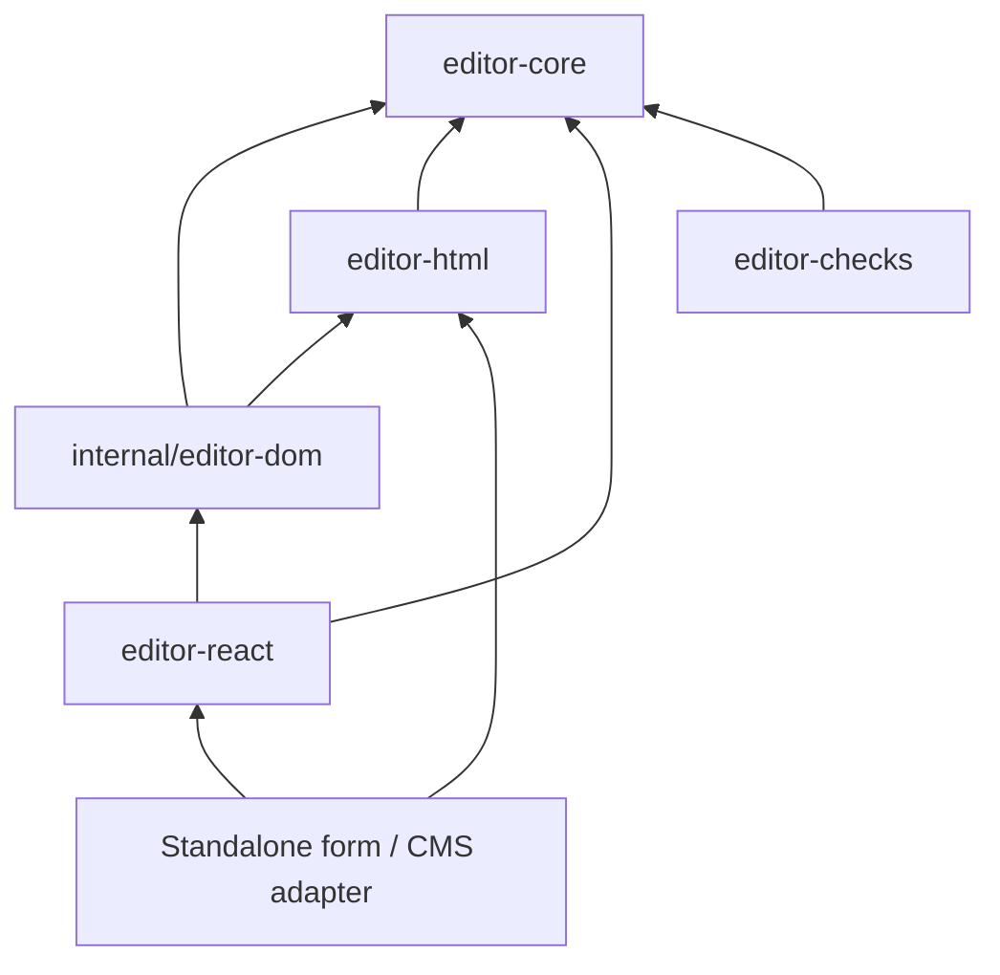

# Inkforge — Editing Engine Specification v0.1

LIB-03 / D-LIB-03 ใช้ document model และ React adapter จาก repo เดิม ออกแบบ kernel ที่รองรับ [Nested Contract LIB-05](https://github.com/adisaktimtong/enterpises_cms/blob/codex/cloud-environment-setup/docs/architecture/23-nested-editor-coordination.md) และใช้ได้โดยไม่พึ่ง Page Builder/CMS แบบนี้เป็น design draft; ยังไม่ใช่ public API ที่ implement แล้ว

[Engine Registry](../../contracts/inkforge-engine-contract.json) มี rules, command catalogue, mapping vectors, pinned evidence และ designed acceptance cases ส่วน [Work Item](../work-items/LIB-03-inkforge-engine/intent.md) เชื่อมขั้นตอน SDLC พร้อม [Decision Record](../work-items/LIB-03-inkforge-engine/decision.md) แสดงผลกระทบต่อแบบเดิมและเหตุผลที่ไม่เริ่มจาก editor kernel ของระบบอื่น

## 1. ใช้แบบและโค้ดเดิมอย่างไร

Source baseline: `adisaktimtong/inkforge@9d7392d1aae9ef6c25040ce7c2318324f0a55d35` ตรวจด้วย git show ไม่ใช้ working-tree prototype แทน committed code

| Input | สิ่งที่มีจริง / การใช้ต่อ |
| --- | --- |
| editor-core/src/index.ts | DocumentNode, paragraph/heading/list/list-item/text/link/hard-break, marks และ constructors/traversal มีจริง ใช้ semantic shape เดิม |
| editor-react/src/index.ts | InkForgeEditor, value/defaultValue/onChange/onDiagnostics และ forwarded HTMLDivElement ref มีจริง ต้องคง compatibility |
| toolbar.ts / formatting.ts / inline.ts | มี formatting, live Range และ DOM/native history paths ใช้ behavioral fixtures ต่อได้ แต่ไม่ใช้ private functions เป็น engine API |
| internal/editor-dom/src/index.ts | ยังเป็น placeholder ใน committed source; event ownership ตามแบบยังไม่ถูกย้ายมาที่นี่ |
| Architecture Spine AD-1/2/3/18/19/20 | มีแบบ self-owned pure kernel, session/revision/selection/history/plugin และ DOM owner อยู่แล้ว; เอกสารนี้ลงรายละเอียดและ reconcile กับ CMS ไม่อ้าง ADOPTED ว่า runtime เสร็จ |
| tests/contracts และ tests/browser | มี public React/HTML/toolbar tests; ยังไม่ได้รันกับ engine ที่เสนอ และ package test บางรายการยอม passWithNoTests จึงต้องอ่าน actual executed cases |

Architecture.md รุ่นเก่าเป็น supporting design และชี้ Spine เป็นหลักอยู่แล้ว ตัวอย่าง RichTextEditorRef ในเอกสารไม่ใช่ export ปัจจุบัน อย่าแทน DOM ref เดิมด้วย engine handle โดยเงียบ

## 2. Package และ authority

editor-core เป็นเจ้าของ model IDs/position/selection/operation/transaction/history/command/plugin state; ไม่ import DOM, React, Node APIs, HTML parser/sanitizer หรือ persistence transport Runtime configuration และ segmentation/identity services ส่งเข้าทาง immutable ports; reduce step ต้อง deterministic จาก state + command + explicit inputs

editor-html เป็นเจ้าของ policy/evaluator/normalization/canonical serialization ฝั่ง HTML; bridge ส่ง validated model slice/canonical witness เข้า engine แทนให้ core import HTML package กลับ เกิด dependency cycle ไม่ได้ internal DOM/source ต้องถูก bundle เข้า public React artifact ตาม owning package build ไม่ให้ npm consumer ต้อง resolve private workspace dependency

## 3. State และ runtime node identity

Proposed state มี document, sidecar node index, selection, storedMarks, history, immutable configuration และ counters ต่อไปนี้:

| Counter / identity | เปลี่ยนเมื่อใด |
| --- | --- |
| engineInstanceId | สร้าง controller ใหม่; แยก editor หลายตัว |
| sessionId | load/import ที่เป็น external replacement, reset owner หรือ new session; echo ไม่เปลี่ยน |
| revision | +1 ต่อ committed **document** transaction รวม undo/redo; noChange/rejected/selection-only ไม่เพิ่ม |
| stateVersion | +1 ต่อ observable state publication เช่น selection/stored marks/composition/readonly/history baseline; document commit อาจเปลี่ยนหลายค่าใน publication เดียว |
| selectionEpoch | +1 เมื่อ user เปลี่ยน selection/caret intent; transaction mapping ใช้ source revision ไม่ปลอมเป็น user movement |
| saved/parent witness | อัปเดตได้เฉพาะ exact acknowledgement ของ host; แยกจาก current revision |

revision และ selectionEpoch นับภายใน session ใหม่เริ่มที่ 0 หลัง validated initial load ส่วน stateVersion monotonic ตลอดอายุ engine instance Snapshot token จึงต้องมี sessionId เสมอ loadExternal ทำ new session/clear incompatible history โดยไม่ปลอมเป็น user edit transaction และไม่ถือว่า server Save เกิดขึ้น

ใช้ sidecar IDs ของ engine เพื่อรักษา public DocumentNode/constructors เดิม ไม่บังคับเติม id ใน input AST ทุกตัว Engine import ทำ deep validation/copy และกำหนด IDs ใหม่; snapshot มี immutable ID-addressable view ที่ public selection/lookup ใช้อ้างได้ โดยไม่ persist IDs ใน HTML หรือ cms.richText properties

ID คงเดิมเมื่อ node เดิมแก้ข้อความ/ย้ายที่; split เก็บ ID ฝั่งซ้ายและออก ID ใหม่ฝั่งขวา; join เก็บฝั่งซ้ายพร้อม map ฝั่งขวา Undo restore ID ของ **logical node เดิม** จาก history ได้ allocator ไม่ย้อน counter เพื่อเอา ID ไปใช้กับ node ใหม่ Duplicate/paste/import ออก ID ใหม่ทั้งหมด Model input ที่มี cycle/shared object aliases/duplicate imported identities ให้ reject หรือ canonical clone ผ่าน explicit import policy ก่อนสร้าง index ไม่ใช้ object reference เป็น durable public identity

ไม่มีการเพิ่ม RawHtml/image/table/code-block เข้า baseline union โดยอัตโนมัติ Plugin/schema extension ต้องมี public typed compatibility, serializer/policy และ capability gate ของตัวเอง Safe unsupported original ต้อง preserve/read-only ที่ HTML/host boundary; ไม่ drop แล้วเปิด editable หาก CMS profile ไม่ยอมรับเนื้อหานั้น

## 4. Position, range และ Unicode

Position ตาม Spine AD-19: `{nodeId, offset, affinity: forward|backward}` Selection เป็น `{anchor, head}` ที่คงทิศทาง backward selection; ordered start/end คำนวณตอน command ไม่เขียนทับ anchor/head ต้นฉบับ

| Node | offset unit / valid bounds |
| --- | --- |
| Text | UTF-16 code units: 0..text.length; ห้ามจุดกึ่งกลาง surrogate pair |
| Document, paragraph, heading, link, list, list-item | boundary ระหว่าง direct children: 0..childCount; list ใช้ items เป็น child sequence |
| Hard break / future atomic node | อ้าง parent boundary ก่อน/หลัง node; ไม่มี caret ภายใน atomic node |

ลำดับ document order มาจาก indexed tree ไม่ใช้การเทียบ string IDs Container boundary map ไป legal text caret ตาม affinity หากไม่มี text ให้ใช้ container offset ที่ถูกต้อง Empty document มี canonical empty caret; visual placeholder ไม่กลายเป็น stored text/BR โดยอัตโนมัติ

UTF-16 เป็น address unit; character-delete ใช้ grapheme boundaries ตาม immutable segmentation port ที่ owner ระบุ locale + implementation/data/runtime fingerprint Word-delete ใช้ locale-aware word policy ที่แยกจาก grapheme ห้ามลบไทย/emoji โดยใช้ offset ±1 อย่างเดียว หาก provider ขาด/ไม่ตรง capability ให้ unsupported พร้อม diagnostic ไม่ fallback เป็น code-unit deletion

ผลจาก segmentation/layout provider ต้องตรวจ range อยู่ใน captured document, ordered และมี legal boundaries ก่อน compile operations Provider throw/ผลอยู่นอกขอบเขตทำให้ command reject โดย document/selection/history ไม่เปลี่ยน ไม่เชื่อ callback เพียงเพราะส่งมาจาก configuration

ไม่อ้าง full UAX conformance จากการเรียก Intl.Segmenter: ใช้ [Standards text-unit policy](https://github.com/adisaktimtong/enterpises_cms/blob/codex/cloud-environment-setup/docs/architecture/21-pagebuilder-standards-and-conformance.md) พร้อม fixtures และ actual runtime/data cohort ไม่มี automatic NFC/NFKC normalization; byte limits, code points, UTF-16 และ graphemes ต้องเรียกชื่อตรง unit

`line` ของ Core หมายถึง logical line ที่จบด้วย hard break/block boundary ส่วน browser soft-line deletion ที่ขึ้นกับการ wrap ต้องให้ DOM adapter ส่ง measured range พร้อม layout/model revision ที่ตรวจได้ หากไม่มี fresh layout range ให้ unsupported ไม่เดาตำแหน่งจากความกว้างหรือใช้ logical line แทนโดยเงียบ

### 4.1 Mapping rules

ทุก primitive operation ส่ง PositionMap พร้อม inverse/history information; normalization operations ต้องร่วม mapping chain ด้วย:

| Operation | Mapping |
| --- | --- |
| insertText ที่ p ยาว L | offset < p คงเดิม; > p เพิ่ม L; = p ใช้ affinity (forward ไปหลัง, backward อยู่ก่อน) |
| deleteText ช่วง [a,b) | < a คงเดิม; > b ลด b-a; ภายใน/ขอบช่วง collapse ที่ a ของ surviving node |
| splitText ที่ p | offset > p ย้าย node ขวา offset-p; = p forward → right/0, backward → left/p |
| joinText | right/x → left/(oldLeftLength+x); left positions คงเดิม |
| remove subtree | forward → legal boundary ถัดไป, backward → ก่อนหน้า; หากไม่มีด้านที่เลือกจึงใช้ขอบที่รอดอีกด้าน; ไม่มีทั้งคู่ใช้ canonical empty caret |
| move subtree | IDs/caret ภายใน subtree คงเดิม; container boundaries ของ old/new parents map ตาม removal+insertion |
| merge adjacent equal text | เก็บ left ID; right offsets map ไป left length ก่อน merge + offset; ไม่มี bookmark ชี้ ID ที่หายโดยไม่ map |

เลือกทั้งช่วงคร่อมหลาย node ให้ map anchor/head ตาม operation sequence เดียวกัน ตรวจกลับว่า points อยู่ใน document/result schema และไม่อยู่ใน forbidden grapheme boundary จาก user deletion ที่ engine สร้าง Explicit command ที่ส่ง invalid node/offset ให้ reject ไม่ clamp เงียบ DOM adapter อาจแปลง browser boundary เป็น legal model pointด้วย documented affinity แล้วส่ง diagnostic หากแก้ตำแหน่ง

Bookmark มี engineInstanceId/sessionId/revision/selectionEpoch + anchor/head Internal synchronous mapping ผ่าน transaction map ได้ถ้ามี chain ครบ แต่ host dialogs/AI/check-repair ที่ใช้ **exact revision** ตาม LIB-05 ต้อง stale หลัง content change ไม่ auto-map แล้วอ้าง fresh การ restore ข้าม session/owner/auth ใช้ไม่ได้ แม้หา nodeId เจอ

## 5. Command และ transaction contract

Proposed `dispatch` envelope: requestId, expectedSessionId, expectedRevision, optional expectedSelectionEpoch (required สำหรับ caret-dependent UI intent), command พร้อม typed payload และ origin จาก registered caller port Origin เป็น provenance ไม่ใช่ authorization grant แค่ส่ง origin=system ไม่ได้ข้าม permission/profile

| Command family | Concrete behavior |
| --- | --- |
| insertText / replaceRange | Replace ordered range แล้วใส่ text; collapsed typing ใช้ stored marks; one atomic transaction |
| deleteRange / deleteBackward / deleteForward | Delete selection หรือ grapheme/word/line range ที่ provider ยืนยัน; boundary ข้าม block ต้องใช้ schema-aware join |
| splitBlock / insertHardBreak / joinBlocks | Enter/Shift+Enter/Backspace ขอบ block ใช้ structural rules ไม่แทรก DOM tag โดยตรง |
| setMark / clearMark / setStoredMarks | Non-collapsed range split leaves ด้วย mapping; collapsed mark เป็น transient stored marks จนมี input |
| setBlockType | paragraph↔heading ตาม schema/profile; preserve inline content; heading level validate |
| wrapList / unwrapList / indentList / outdentList | Operate selected contiguous item/block set, preserve nested descendants และไม่ย้าย sibling ที่ไม่เลือก |
| setLink / removeLink | Link คือ inline node ตาม baseline; no nested links, split/merge preserving marks; href/profile/typed reference ต้องผ่าน HTML/host bridge |
| insertSlice | Validated model slice + open-boundary metadata ที่ explicit; clipboard/import ออก IDs ใหม่; fit schema ก่อน commit |
| undo / redo | Engine-owned history group; inverse operations + selection/stored marks restore; revision เพิ่มตาม document change |
| replaceExternalDocument | Lifecycle/load port ของ host; new session, history reset; echo ไม่ผ่านคำสั่งนี้ |

Full tagged payload catalogue อยู่ registry Generic unrestricted set-any-node/replaceDocument ไม่ใช่ input command หลัก Public plugin command compile ลง registered validated operations ได้ แต่ห้าม mutate state/DOM หรือ inject arbitrary function ใน persisted metadata

### 5.1 Atomic pipeline

1. Guard lifecycle/readOnly/composition lock, expected session/revision/selection และ registered command capability; duplicate request identity ต้องได้ผลเดิมเฉพาะ envelope เดิม
2. Compile command จาก immutable state → ordered operations + selection intent + explicit history boundary โดยไม่ mutate shared state
3. Apply บน isolated candidate พร้อม runtime IDs, inverse operations และ PositionMap chain
4. Normalize ตาม deterministic registry order ไป fixed point; repeated **changed** document digest หรือเกิน configured pass limit → NORMALIZATION_DID_NOT_CONVERGE; stable unchanged pass คือ converged ไม่ใช่ loop
5. Validate entire candidate schema/limits/profile-independent capabilities/positions และ output safety descriptors; HTML security verdict ต้องได้จาก owner boundary ไม่ให้ core สวมบท sanitizer
6. Candidate semantic document เท่าเดิม → noChange ไม่มี revision/history/redo invalidation; ถ้า selection/stored marks เปลี่ยน ให้ publish state-only change ตาม flags
7. Commit document transaction ครั้งเดียว → revision+1, history/mapping, immutable snapshot และ ordered event publication; subscriber failure ไม่ rollback หรือทำให้ dispatch committed กลายเป็น rejected

Core dispatch/undo/load ที่เรียกซ้อนจาก subscriber ถูก REENTRANT_MUTATION ให้ consumer queue หลัง dispatch แล้วตรวจ captured expected token ใหม่ ห้าม auto-restamp stale request Engine ไม่รัน async plugin transaction กลาง atomic commit; ผล async กลับมาเป็น command ใหม่ที่มี fence

Result แยก status `committed|noChange|rejected|stale|disposed|pendingComposition`, documentChanged/stateChanged, requestId/session/revision/stateVersion, diagnostics และ mapping reference คำว่า committed หมายถึง local document commit เท่านั้น ไม่มี server Save acknowledgement แฝง

## 6. Structural command rules

Enter กลาง paragraph/heading split block พร้อม inline marks/link boundary mapping; heading ที่ท้าย Enter สร้าง paragraph ถัดไป ส่วน heading กลางคง type ทั้งสองฝั่งตาม declared command policy Backspace ที่ต้น block รวมเฉพาะ compatible blocks/list contexts ไม่ flatten unknown/opaque structure

Empty list item Enter/outdent ออกจากหนึ่งระดับโดยรักษา sibling order; item ที่มี nested list ต้องย้าย descendants ตาม legal transform หรือ reject พร้อม diagnostic ไม่ทิ้ง child เนื้อหา Nonempty item split ที่ caret และรักษาท้ายข้อความ/mark/list attributes Selected item range ที่ข้ามหลาย list contexts compile เป็น transformations ที่ตรวจ fit ทั้งชุด ไม่สำเร็จบางส่วน

Collapsed setMark อัปเดต stored marks/toolbar state โดยไม่ทำ document dirty เมื่อ selection ย้ายไป logical context ใหม่ให้ recompute inherited marks แล้ว clear ephemeral override; field focus ไป toolbar/dialog เดิมไม่ clear โดยไม่มีเหตุ SetMark และ removeLink ไม่ล้าง marks อื่นที่ไม่ได้สั่ง Presentation class/style เดิมต้องผ่าน active profile ที่ boundary ไม่ขยาย CMS v1 ด้วยการย้ายอำนาจเข้า kernel

## 7. History และ saved witness

History entries เก็บ forward/inverse operation groups, ID/mapping restoration, before/after selection และ stored marks ไม่เก็บ DOM snapshots Typing group รวมได้เมื่อ session/input origin/adjacent caret/direction/marks/profile เหมือนกันและห่างกันไม่เกิน **1,000 ms** จาก injected monotonic clock (proposed configurable default) การ delete คนละทิศ, selection move, format/paste/list/link, composition, field boundary, save barrier, auth handoff และ undo/redo ปิด group

Composition หนึ่งรอบเป็น history group เดี่ยว New accepted document edit หลัง undo ตัด redo branch; selection-only/noChange/rejected edit ไม่ตัด redo Group limits/byte budget นับทั้ง forward/inverse/mapping/selection/diagnostics payload ที่เก็บจริง Eviction ไม่ลบ current document/saved checkpoint และไม่ rewind ID allocator; หาก transaction ใหญ่เกิน hard budgetให้ reject ก่อน commit หรือใช้ explicit non-undoable import flow ที่ผ่าน owner action ไม่ commit แล้วอ้าง undo ได้

Saved checkpoint/witness เป็น host-confirmed baseline ของ canonical output ไม่ใช้ revision number เท่ากันเป็น dirty oracle เพราะ Undo อาจคืน content เดิมที่ revision สูงขึ้น `dirty = currentContent != acknowledgedBaseline OR unresolvedLocalCandidate`; stored marks/selection ไม่ทำ content dirty

Engine pure state เก็บ content equality witness/checkpoint lineage ส่วน LIB-04 bridge คำนวณ canonical HTML + profile/cohort fingerprint มาคู่กัน ห้าม compute HTML digest จาก DOM host ack ต้องชี้ captured session/revision/checkpoint + exact content witness ที่ยังอยู่ใน bounded ledger การ ack B ขณะ current C ยอมรับ B เป็น baselineได้โดย C ยัง dirty; stale/older baseline/released/wrong profile ack ปฏิเสธ การกลับมาตรง baseline จาก Undo clean ได้โดยไม่สร้าง server write ใหม่

Parent-accepted witness กับ server-saved witness แยกกันตาม LIB-05 สำหรับ standalone host เป็นผู้ยืนยัน save ของตน Inner engine ไม่ import Go endpoint/Builder checkpoint และไม่ auto-save

External parent undo/redo ที่ทำให้ child เปิด session ใหม่ยังเป็น unsaved parent action ห้าม initialize server baseline ให้เท่าค่าใหม่แล้วล้าง dirty Host เก็บ saved witness ของ save unit เดิมและส่ง bootstrap origin/baseline ที่ชัดเจน ส่วน persisted owner load จะตั้ง baseline ได้เฉพาะข้อมูลที่ host ยืนยันว่าบันทึกแล้ว Checkpoint callbacks ของ child session เก่าถูก invalidate แม้ host ยัง resolve parent Save receipt เดิมภายใต้สิทธิ์ที่ถูกต้องได้

## 8. DOM adapter และ input ownership

internal/editor-dom เป็นผู้แก้ editable subtree และรับ beforeinput/input/composition/paste/cut/drop/selection/mutation เพียงทางเดียว React/plugins สั่งผ่าน controller; React render จัด toolbar/wrapper ไม่ reconcile children ขณะพิมพ์

| Browser path | Owner behavior |
| --- | --- |
| Cancelable supported beforeinput | preventDefault → one command → render minimal patch + mapped selection; input event ที่ตามมา dedupe ตาม input cycle |
| Noncancelable/spellcheck/autocorrect/replacement | Capture pre-state/affected region; allow bounded native DOM change, reconcile affected slice into one command; do not capture whole innerHTML as document authority |
| Paste / cut | Parse/validate in HTML boundary, apply one insertSlice/delete transaction; clipboard permission/failure leaves document untouched |
| historyUndo/historyRedo / keyboard | One router to engine; intercept browser history where supported; prevent outer double handling; unsupported reliable ownership disables capability in that cohort |
| Drop | Default baseline reject as existing behavior; drag/drop insertion needs dedicated validated slice/file host capability before enabling |
| MutationObserver | Distinguish own render patch from native/unexpected mutation; validate candidate diff or quarantine retained draft with diagnostic; never silently trust unrecognized DOM |

Clipboard prefers supported safe HTML plus explicit plain-text fallback policy Newlines from plain text use one declared paragraph/hard-break policy and preserve literal text escaping HTML with removed/unsupported meaningful content needs loss diagnostics/review; script/event handlers never enter editable DOM in fallback/recovery UI

Unsupported native input type reports capability/diagnostic and retains a safe candidate while authorized; no native execCommand path in **engine-owned mode** Multiple editor instances have separate event root/session, no global active-editor variable deciding destination

## 9. IME composition protocol

State machine ใน DOM adapter: idle → composing → finalizing → idle หรือ invalidDraft; terminal disposal จากทุก state ได้ Engine retains committed pre-composition state; transient buffer/base selection/input cycle/native DOM region อยู่นอก committed document/history แต่ coordinator เห็น composing/localCandidate แล้ว

1. compositionstart capture engine session/revision/selection and composition ID, close typing group; stable committed snapshot คงเดิม
2. compositionupdate/beforeinput(inputCompositionText)/input อัปเดต transient buffer ไม่ dispatch duplicate text, sanitize/re-render หรือ force selection reset
3. compositionend หรือ browser-confirmed final input boundary รวบรวม final replacement slice; normalize/validate แล้ว dispatch **หนึ่ง** transaction with composition origin/ID; trailing final input event ต้อง dedupe แม้ order ต่างกัน
4. Valid commit → one revision/history group, safe DOM reconcile/selection map และ submit stable child snapshot ให้ parent; cancelled/empty no-op → noChange; invalid candidate → keep inert safe draft + diagnostic in memory, committed model/history ไม่เปลี่ยนและ Save blocked
5. Save/Preview/AI Apply ระหว่าง composing คืน pendingComposition ไม่บังคับ blur หรือเรียก finalize เพื่อเร่งบันทึก Blur ที่ browser ยืนยันจบจริงอาจ finalize once ได้; ถ้า browser ยัง composing ให้พัก pending และไม่สร้าง timeout correctness path

invalidDraft ต้องมีทางกลับไปทำงาน: แสดง safe draft พร้อม field diagnostic, ให้แก้/ลองตรวจใหม่ใน repair surface ที่อยู่ภายใต้ profile เดิม หรือเลือก discard อย่างชัดเจน Retry ที่ผ่านแล้วจึง dispatch one replacement transaction จาก captured committed base หาก base เปลี่ยนให้ stale และคง draft ไว้ ไม่ใช้ repair เป็นช่องเปิด Source/Raw HTML ใน CMS profile และไม่ render unsafe candidate เป็น active HTML

Toolbar/structural/history command ขณะ composing ต้อง defer/block ด้วย visible state ตาม intent ไม่แทรก engine mutation เข้า native buffer Keyboard editing ที่ IME เป็นเจ้าของต้องไม่ถูก page/history shortcut รับซ้ำ External echo ของ accepted revision เก่าต้องไม่ replace DOM; nonterminal external replacement รอให้ finalize/resolve แล้วจึง owner action ไม่เอา pending controlled value มาทับผล composition

Read-only/disabled policy transition ขณะ composing ที่ยัง authorized ให้พัก destructive operations และเก็บ safe candidate แต่ไม่ส่งเป็น committed textจนตรวจผ่าน Hard expiry/logout/revoke/different actor dispose และ clear protected state ตาม [Session Continuity](https://github.com/adisaktimtong/enterpises_cms/blob/codex/cloud-environment-setup/contracts/cms-session-continuity.json) ไม่มี promise ว่าจะ finalize หรือกู้ native composition หลัง terminal event

ข้อที่ต่างจาก upstream AD-20 เรื่อง cancel invalid buffer/disposal บันทึกใน Decision Record แล้ว เป็น design adaptation ให้รักษา LIB-05 draft/security contract ไม่แก้ต้นฉบับ repo Inkforge ในรอบนี้

## 10. React compatibility และ proposed public ports

คง `InkForgeEditor`, value/defaultValue semantics, callbacks และ forwarded HTMLDivElement ref เดิม เพิ่ม opt-in engine/controller binding หรือ hook ผ่าน public export ใหม่หลัง review compatibility ห้ามเปลี่ยน ref เป็น engine handle ใน minor change Consumer เดิมที่ไม่ใช้ ports ยังคงใช้ API เดิม แต่ไม่ถือว่าผ่าน CMS nested capability

Proposed controller vocabulary: createEngine, getSnapshot, subscribe, dispatch, setSelection, captureBookmark, restoreBookmark, loadExternal, setReadOnly, closeHistoryGroup, captureCheckpoint, acknowledgeCheckpoint, releaseCheckpoint, dispose; LIB-05 observeField/prepareField/acceptExternalValue เป็น bridge บน public controller + HTML boundary ไม่ต้องมี Builder dependency ใน Inkforge

useSyncExternalStore อ่าน immutable snapshot ที่ object reference คงเดิมเมื่อ state ไม่เปลี่ยน subscriptions cleanup idempotent, React Strict Mode setup/cleanup ต้องไม่ dispose external engine ที่ host ยังเป็นเจ้าของ ไม่ create session ใหม่ทุก render Canonical parent echo เปรียบ accepted request/witness ก่อน value equality; equal string คนละ owner/session ไม่ใช่ echo

Controller engine-owned mode เป็น opt-in ระหว่าง transition และเปิด defaultได้หลัง behavioral/package/Next cohort ผ่านเท่านั้น ห้ามผสม native history กับ engine history ใน instance เดียว Shadow diagnostics/prototype ไม่ถือเป็น second authority ที่แอบ commit

## 11. Plugin registry, bounds และ lifecycle

Registry compile ก่อนเปิด session; reject duplicate plugin/node/mark/command/rule IDs, overlapping parse priority tie และ missing/multiple serializer ตาม owner contract Config/profile/token registry fingerprint immutable เปลี่ยนเมื่อเปิด session ใหม่ Plugin operations ต้องมี validation/inverse/map semanticsครบก่อนเปิด capability Hook ทำ observe/enqueue; async result กลับมาเป็น captured revision command พร้อม host fences

Compilation ของ command/schema/map อยู่ Core ส่วน parse/serializer/policy descriptor อยู่ editor-html/host registry coordinator ที่ตรวจ joint capability ก่อน enable ไม่ให้ core import parser callback เพื่อทำ registry ให้ดูครบ Checkpoint ledger รับ pin/release จาก host ได้ แต่ไม่อ่าน Go receipt หรือ network status เอง

กำหนด finite configuration ก่อนสร้าง engine: max document bytes/nodes/depth/text UTF-16, operations/transaction, normalization passes, history entries/bytes, checkpoint records/bytes และ mapping ledger span ตรวจ integer/range/config consistency; ไม่มี unlimited queue หรือ zero-test readiness ตัวเลข production limits ไม่อ้างว่า measured แล้ว Budget matrix อยู่ registryเป็น proposed test configurationที่ต้องประกาศ actual cohort limitsก่อน enable

Dispose idempotent/terminal: cancel adapter listeners/observers/async tools, clear protected model/history/buffer/checkpoints/search/selection references และ suppress late callbacks แยก lifecycle suspend ของ React surface จาก dispose engine จริงตาม owner; presentation unmount ไม่ล้าง rejected draft ที่ coordinatorยังถือโดยไม่มี owner action

## 12. Delivery และ acceptance

[Implementation Plan](../work-items/LIB-03-inkforge-engine/plan.md) แบ่ง pure model/selection → transactions/commands → history/checkpoints → DOM/IME → React/packed/standalone ก่อน LIB-04/05 integration ไม่เริ่มเขียน CMS เพื่อทดแทน engine ที่ยังขาด

[Test Plan](../work-items/LIB-03-inkforge-engine/test-plan.md) ใช้ source-pinned requirements + deterministic mapping vectors/race schedules และ actual native Thai IME/browser cohort Synthetic events ไม่ใช่หลักฐาน native IME ทั้งหมด Results แยก Core, browser, public package/Next, standalone และ combined CMS cohort ไม่มี case ใด passed จากการเพิ่ม spec/registry

LIB-04 HTML policy/Go parity, LIB-02 DS, LIB-05 ack/barrier และ LIB-10 certified cohort ยังมี gates ของตัวเอง การออกแบบ kernel เสร็จไม่ทำให้ optional Source/Raw HTML/media/plugin enabled ใน cms-body-v1 และไม่เปลี่ยน `certifiedRuntime: null`

## U07-B implemented controller subset

[Implementation decision](../work-items/LIB-03-inkforge-engine/u07b-controller.md) / [actual evidence](../work-items/LIB-03-inkforge-engine/u07b-evidence.md) identify the new public createEngine/EngineController. Typed issued tokens, sidecar model IDs, granular operations/maps/history/checkpoints and pure composition protocol now exist for the declared subset. DOM/React engine ownership, host acknowledgments and the complete command/plugin catalogue above are not globally implemented. The original replaceDocument prototype remains separate and unchanged.

## U07-C supported native binding

[Current delivery](../work-items/LIB-03-inkforge-engine/u07c-native-surface.md) / [evidence](../work-items/LIB-03-inkforge-engine/u07c-evidence.md) now bind the public controller to one private DOM writer, an opt-in React engine surface and shared toolbar. The qualified Chromium input/IME/lifecycle subset is implemented; complete profile/host/command/browser-family acceptance above remains partial.
## Implemented U07-D boundary

[Host bridge and original-context amendment](../work-items/LIB-03-inkforge-engine/u07d-host-boundary.md) are implemented through editor-html/engine and editor-react/host, with a separate actual Builder port. [Evidence](../work-items/LIB-03-inkforge-engine/u07d-evidence.md) remains scoped to field delivery; a field ack does not acknowledge the server checkpoint.
